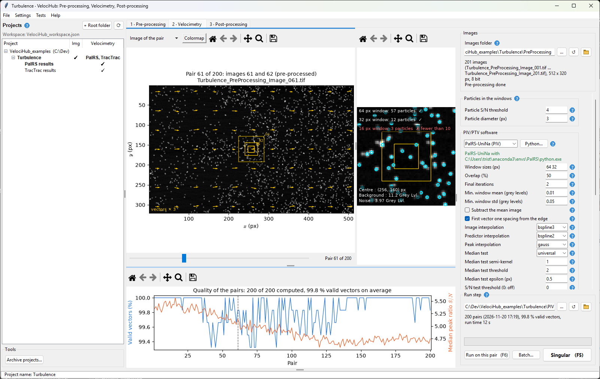
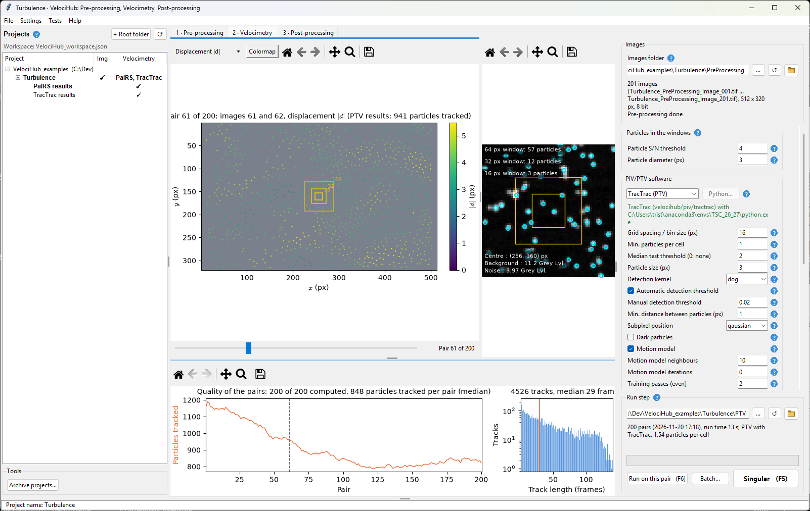
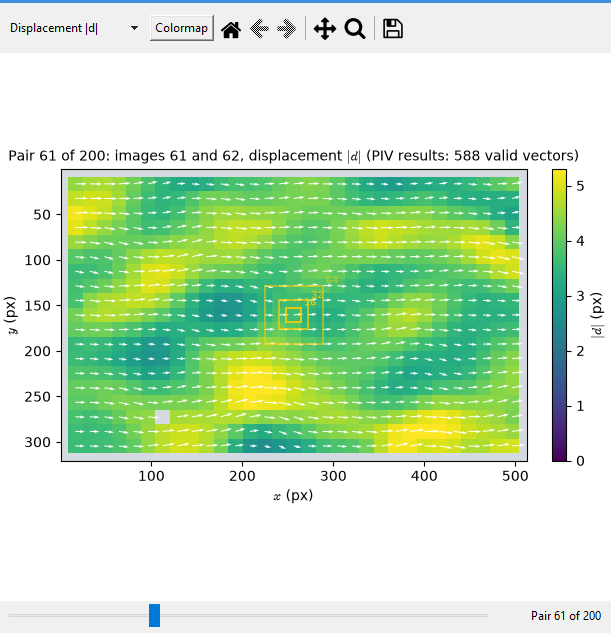
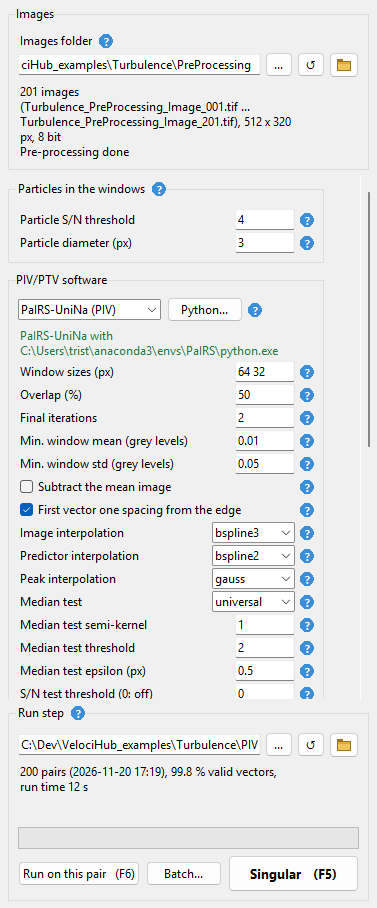

# Part 2 — Processing (PIV / PTV)

The processing computes the displacement of the particles between the two images of each pair, **in pixels**, with a
PIV/PTV *engine*:

- **PaIRS-UniNa (PIV)** — cross-correlation, multigrid passes with image deformation (G. Paolillo, T. Astarita,
  University of Naples Federico II). Runs in its own Python 3.10-3.13 process.
- **TracTrac (PTV)** — particle detection, motion model and tracking over the image sequence (J. Heyman 2019);
  the particles linked in each pair are also binned on a grid, so the PTV gives vector fields like the PIV, plus the
  tracks of the particles. Vendored in `velocihub/piv/tractrac`.

An optional **regression** (SPICY, constrained radial basis functions, VKI) can follow either engine, to fill the
gaps of invalid vectors and smooth the noise. SPICY fits scattered data: after TracTrac it fits the particles of each
pair themselves (not the binned cells), after PaIRS its valid vectors; the fit is evaluated on the grid.

Modules: `velocihub/piv/` (`base.py`: `PIVRun`, `Camera`, engines; `pairs_engine.py`; `ptv_engine.py`;
`regression.py`; `particles.py`), page: `velocihub/gui/piv_page.py`. Other engines can be added: subclass
`PIVEngine`, decorate it with `@register` (see `base.py`).

*The page Velocimetry after a PIV with PaIRS-UniNa (windows of 64 and 32 px, 50 % overlap) of the synthetic turbulence
of the [benchmark](benchmark.md): pair 61 with its vectors (x 3) and the three windows of the particle diagnostic, the
largest magnified on the right (57, 12 and 3 particles: the 16 px window has too few); below, the valid vectors and
the median correlation peak ratio of the 200 pairs. Right: the side panel, with the settings of the engine.*

## Features

- **Images used**: those exported by the pre-processing with the current recipe (exported first if needed, the POD
  modes evaluated if missing), the original images when the recipe is empty, or any other folder (used as it is, with
  the masks of its `preprocessing.json`).
- **Pairs**: each image with the next one (k, k+1), all the pairs.
- **Background run**: the PIV runs in another process; the interface stays usable. The pairs are saved by chunks of
  100: **Stop** keeps them and the next run continues from there (also after a crash).
- **Live view**: the pair just computed is shown while the PIV runs (unless you are browsing other pairs).
- **Run on the pair shown** (F6): computes only the pair on screen (with 10 frames around it for TracTrac's motion
  model), to tune the settings in seconds.
- **Image tile views** (menu in the tile header): *Image of the pair* (with the interrogation windows and the
  vectors × 3), *Displacement |d|*, *d_x*, *d_y*. For the PIV, the map on its grid (arrows on |d|); for the PTV, the
  tracked particles themselves, coloured by their displacement between the two frames (the grid cells while the PTV
  runs, before its tracks are saved). Colour limits are those of all the pairs (99th percentile).
- **Particles in the windows**: a seeding diagnostic independent of the engine. Three nested windows (64, 32, 16 px by
  default) on the image, moved by click/drag, resized with the mouse wheel; the largest is magnified with the
  particles circled and counted in each window (about **10 particles per window** are needed).
- **Quality of the pairs**: valid vectors (%) and median correlation peak ratio per pair (PIV), or the particles
  tracked per pair and the histogram of track lengths (PTV: no valid-cell percentage, not a reliable quality of its
  binning); click a point to show that pair.
- **Masks**: vectors whose window centre is masked get status 2 (masked) and are excluded everywhere.

*The same pairs tracked by TracTrac (PTV), view Displacement |d|: the particles tracked in pair 61, coloured by their
displacement. Below: the particles tracked per pair and the histogram of the lengths of the tracks.*

*View Displacement |d| of the PIV: the map on its grid, the vectors drawn over it.*

## Parameters

### Images and run (side panel)

*The side panel: the images used, the particles in the windows, the PIV/PTV software and its settings (scrolled
further: the regression) and the run step (results folder, Run on this pair, Batch... and Singular).*

| Interface | API | Meaning |
|---|---|---|
| Images folder (pre-processed by default, `...` another folder, ↺ back) | `run_piv(images, ...)` — list of paths in time order | The images the PIV reads. |
| PIV/PTV software | `engine="PaIRS-UniNa"` or `"TracTrac"` | The engine. |
| Run step > results folder (`PIV`, or `PTV` for TracTrac) | `output=` | Folder of `vectors.npz`, `settings.json` (and `tracks.npz`). |
| Singular (F5) / Stop | `run_piv(...)`, `PIVRun(...).run()` | All the pairs. |
| Run on the pair shown (F6) | `PIVRun(images, pairs=[(k, k + 1)], ...)` | One pair. |
| Settings > PaIRS Python interpreter... | `get_engine("PaIRS-UniNa", python="C:/.../envs/PaIRS/python.exe")` | Interpreter with PaIRS-UniNa (found automatically among the conda environments otherwise). |

### PaIRS-UniNa (PIV)

| Interface | API key | Default | Meaning |
|---|---|---|---|
| Window sizes (px) | `windows` | `(128, 64, 32)` | Interrogation windows of the multigrid passes, first to final (decreasing, at least 4 px). The final window sets the resolution. |
| Overlap (%) | `overlap` | 50 | Overlap of neighbouring windows: vector spacing = final window × (1 − overlap); 32 px at 50 % gives a vector every 16 px. |
| Final iterations | `final_iterations` | 2 | Iterations of the final pass, the image deformed by the previous displacement. |
| Min. window mean (grey levels) | `min_mean` | 0.01 | Darker windows are not correlated. PaIRS's own default (2) rejects almost every window of dark images; 0.01 only rejects windows without particles (masked areas). |
| Min. window std (grey levels) | `min_std` | 0.05 | Windows with less contrast are not correlated (PaIRS default 3). |
| Subtract the mean image | `subtract_mean` | False | Subtracts the mean of about 200 images from each image. Not needed after the POD background removal. |
| First vector one spacing from the edge | `border` | True | PaIRS: the first vector at a distance equal to the spacing from the image border (else the first window touches it). |
| Image interpolation | `image_interpolation` | `bspline3` | PaIRS: interpolation of the image deformation, multigrid passes and final iterations: `bspline3`/`5`/`7` (B-spline of order 3, 5, 7), `bicubic`, `biquadratic`, `bilinear`, `simplex`, `linrev` (linear revitalized), `sinc3` (sinc, half-width 3), `shift5` (shift theorem, width 5), `moving` (moving window: shifted, not deformed), `none`. |
| Predictor interpolation | `velocity_interpolation` | `bspline2` | PaIRS: interpolation of the dense predictor (the displacement of every pixel, from the vectors of the previous pass): `bspline2`/`3`, `bilinear`, `linrev`, `simplex`, `shift`. |
| Peak interpolation | `peak_interpolation` | `gauss` | PaIRS: sub-pixel interpolation of the correlation peak: `gauss` (Gaussian, classic), `gauss_rev` (reviewed), `simplex`. Its bias is the peak locking. |
| Median test | `median_test` | `universal` | PaIRS: `universal` (normalized median test, Westerweel & Scarano 2005), `classic`, `none`. Outliers are replaced and marked invalid. |
| Median test semi-kernel | `median_kernel` | 1 | PaIRS: neighbours within this many spacings ((2n + 1)² − 1 of them). |
| Median test threshold | `median_threshold` | 2.0 | PaIRS: threshold on the normalized residual (advised 2, range 1-3). |
| Median test epsilon (px) | `median_epsilon` | 0.5 | PaIRS: minimum value of the normalization (advised 0.1-0.5 px; 0: no limit). |
| S/N test threshold | `sn_threshold` | 0 (off) | PaIRS: threshold on the ratio of the two highest correlation peaks (advised 1.5). |
| Correlation peak test | `cc_threshold` | 0 (off) | PaIRS: minimum correlation peak allowed (advised 0.25). |
| Outlier replacement | `outlier_replacement` | `weighted` | PaIRS: `weighted` (distance-weighted average of the valid neighbours), `average`, `iterative`. |
| Correct with the second peak | `second_peak` | True | PaIRS: an outlier first replaced by the displacement of the second correlation peak, when it passes the test. |
| Correlation weighting window | `correlation_window` | `tophat` | PaIRS (Astarita 2007): weighting window of the interrogation windows: `tophat` (none), `tophat50`, `nogueira`, `blackman`, `bharris` (Blackman-Harris), `hann`, `triangular`. |
| Displacement weighting window | `predictor_window` | `tophat` | PaIRS: weighting window that filters the predictor between iterations: `tophat`, `nogueira`, `blackman`, `bharris`, `hann`, `triangular`. |
| Displacement window half-width | `predictor_halfwidth` | 0 | PaIRS: its semi-size in vectors (0: that of the interrogation window). |
| Max. displacement (of the window) | `max_displacement` | `1/4` | PaIRS: the largest displacement allowed, as a fraction of the window (`1/2`, `1/3`, `1/4`, `1/5`). |

The defaults are the PaIRS *standard* process (what VelociHub always used before); the help of each setting in the
page (?) follows the PaIRS interface. The direct correlation stays off, so that PaIRS gives the correlation peak
ratio. The images are read in one channel as every step reads them (`velocihub/greyscale.py`: the brightness
max(R, G, B) of a colour image).

> **Note: the final window filters the small scales.** Each vector is the mean displacement over its window, so the
> structures smaller than about the window are attenuated. The statistics that depend on them come out low: the
> fluctuations a little, the gradients (vorticity, dissipation) much more. The grid spacing alone doesn't set the
> resolution: a 32 px window every 16 px filters more than the 16 px grid.

On the synthetic turbulence of the [benchmark](benchmark.md) (200 pairs, 1 POD mode removed, then the
post-processing), against the exact statistics of the flow. The first row is the exact field on the same 200 maps:
what the record length allows.

| Final window (overlap, grid) | Error of the fields (px RMS) | Outliers removed | RMS of u | Turbulent kinetic energy | Dissipation ÷ best of the grid |
|---|---|---|---|---|---|
| Exact fields, same maps (16 px grid) | 0 | 0 | 0.95 | 1.01 | 0.96 |
| 32 px (50 %, 16 px) | 0.14 | 1 | 0.83 | 0.79 | 0.68 |
| 24 px (33 %, 16 px) | 0.13 | 23 | 0.88 | 0.85 | 0.78 |
| 16 px (0 %, 16 px) | 0.22 | 49 | 0.90 | 0.89 | 0.88 |
| 16 px (50 %, 8 px) | 0.33 | 1711 | 0.89 | 0.87 | 1.01 (of the 8 px grid) |

Smaller final windows recover the fluctuations and the gradients, at the cost of noise and outliers (fewer particles
per window). At 16 px with 50 % overlap the dissipation reaches what its grid allows, partly because the noise adds to
the gradients. Choose the final window from the seeding (enough particles in each window), and expect the
fluctuations, and above all the dissipation, to be underestimated with large windows. A PTV, which doesn't average
over a window, kept 0.92 of the dissipation on the same 16 px grid (0.99 with SPICY).

### TracTrac (PTV)

| Interface | API key | Default | Meaning |
|---|---|---|---|
| Grid spacing / bin size (px) | `spacing` | 16 | The displacements of the particles of each pair are averaged in cells of this size centred on the grid points (16 px matches PaIRS with 32 px windows at 50 %, so PIV and PTV compare point by point). |
| Min. particles per cell | `min_particles` | 1 | A cell with fewer particles in a pair is invalid in that pair. |
| Median test threshold (0: none) | `median_test` | 2.0 | Normalized median test of each cell against its 8 neighbours (Westerweel & Scarano 2005, noise 0.1 px). |
| Particle size (px) | `particle_size` | 3.0 | Size of the detection kernel (TracTrac `peak_conv_size`). 3 px detects fewer but cleaner particles than 2 px. |
| Detection kernel | `kernel` | `"dog"` | Filter before detection: difference of Gaussians `dog`, Laplacian of Gaussian `log`, `none`, or Shi-Tomasi corners `shi-tomasi`. |
| Automatic detection threshold | `auto_threshold` | True | Threshold = mean + ½ std of the filtered image (not with shi-tomasi). |
| Manual detection threshold | `threshold` | 0.02 | Threshold of the filtered images (grey levels / 256 or 65536) without the automatic one. |
| Min. distance between particles (px) | `peak_neigh` | 1 | Closer particles are one particle. |
| Subpixel position | `subpixel` | `"gaussian"` | Fit of the particle position: `gaussian` or `quadratic`. |
| Dark particles | `dark` | False | Dark particles on a bright background. |
| Motion model | `motion` | True | Predicts each particle's displacement from its neighbours in the previous frames (links particles that move further than their spacing). |
| Motion model neighbours | `motion_av` | 10 | Particles averaged by the motion model. |
| Motion model iterations | `motion_it` | 0 | Iterations of the motion model per frame (0: one prediction). |
| Training passes (even) | `vid_loop` | 2 | Passes back and forth over the sequence to train the motion model before the final forward pass (whose tracks are kept). Each pass takes as long as the tracking. |
| Outlier filter | `filter` | True | Rejects particles whose displacement departs from the motion model. |
| Outlier threshold (std) | `filter_std` | 1.5 | Rejection beyond this many standard deviations of the motion-model error. |
| Outlier threshold memory | `filter_time` | 1.0 | Weight of previous frames in the outlier threshold. |
| Subtract a moving background | `background` | False | TracTrac's own background (not needed on pre-processed images). |
| Background adaptation speed | `background_speed` | 0.01 | Update speed of that background (0-1). |
| Median filter / size (px) | `median_filter` / `median_size` | False / 3 | Median filter of the images before detection (3 or 5 px). |

### Regression (SPICY, optional)

| Interface | API (`regression={"method": "spicy", "settings": {...}}`) | Default | Meaning |
|---|---|---|---|
| Regression: None / SPICY | `method` | `"none"` | Fit each displacement field after the PIV/PTV: PTV, the links of the particles of each pair (at the middle of their two positions, with their displacement; those in masked cells left out); PIV, its valid vectors. Evaluated at the grid points with flow. |
| RBF basis | `basis` | `"gauss"` | Gaussian RBFs or `c4` (compact support: faster, slightly less smooth). |
| Points per RBF (per level) | `n_k` | `"auto"` | Data (vectors, or particles after a PTV) each RBF covers, one number per level (e.g. `(4, 10)`: fine + coarse). Fewer: closer fit, slower. `auto`: 3 for the vectors of a PIV, 4 for the particles of a PTV (why: below). A number entered applies to both. |
| Collocation | `method` (of the settings) | `"clustering"` | Where RBFs are placed: k-means `clustering`, Halton `semirandom`, or `regular` grid. |
| RBF radius min / max (image width) | `r_min` / `r_max` | 0.01 / 0.3 | Smallest/largest RBF radius as a fraction of the image width. |
| RBF value at the nearest RBF | `eps_l` | 0.7 | Value of an RBF at its nearest neighbour (0-1), which sets its radius. |
| Divergence penalty (0: none) | `alpha_div` | 0 | Penalty on the 2D divergence. Keep 0 for an axisymmetric jet in a plane through its axis (there du/dx + dv/dy = −v/r). |
| Harmonic basis functions | `n_hb` | 0 | Sines and cosines added for global trends. |
| Condition number | `k_cond` | 1e12 | Regularization of the fit matrix. |
| Particle outlier test (0: none) | `outlier_test` | 3 | PTV: before the fit, each link is compared with the median of its nearest links (the normalized median test of scattered data, Westerweel & Scarano 2005, Duncan et al. 2010; 2 passes): left out if `|d − median| / (median difference of the neighbours + 0.1 px)` exceeds this. The PIV vectors are validated by the PIV. |
| Neighbours of the outlier test | `outlier_neighbours` | 10 | PTV: the nearest links each link is compared with, within 3 grid spacings (with fewer than 4, the link is kept). |
| Fit every n-th map | `map_step` | 1 | SPICY fits the maps 1, 1 + n, 1 + 2n... only; the results hold those maps, with their pairs (`regression_map_step` and `computed_pairs` in `settings.json`). The PIV/PTV still computes every pair, and a PTV keeps all its tracks. For statistics of long time-resolved records: see below. |

`vectors.npz` then holds the regressed fields, plus the raw ones (`raw_u_px`, `raw_v_px`, `raw_info`: the binned
cells of a PTV, set by its grid spacing, min. particles per cell and median test), the residual of each fit (RMS at the
data fitted, px), the number of data fitted (`regression_n_points`) and of links left out by the outlier test
(`regression_n_rejected`). On the benchmark (`docs/benchmark.md`), with 2 % of the links wrong, the test catches 93 to
100 % of them and brings the error of SPICY back within 1.1 times that without wrong links (4 to 5 times without the
test), and leaves out under 0.6 % of the good links. The quality figures keep using the raw PIV/PTV
validity, and the grid points out of the flow (valid in less than 10 % of the pairs) are not evaluated.

> **Note: the points per RBF set how much SPICY smooths, so their default depends on the data.** Each RBF is fitted
> on about `n_k` data: more points per RBF means fewer, wider RBFs, so more smoothing. What suits depends on the data,
> hence the two defaults of `auto` (3 for a PIV, 4 for a PTV; VelociHub 1.2.0 used 4 for both):
> - **PIV vectors** are already averaged over their windows and have little noise: fewer points per RBF follow the
>   field more closely. 3 does better than the default 4 on most flows; 8 smooths out the structures shorter than
>   about 5 grid spacings, and the error becomes larger than that of the vectors it fits.
> - **PTV particles** each carry the noise of a single link: fewer points per RBF average less of it. 3 is worse
>   than 4 on most flows; 8 is better on smooth flows but loses the short structures.

On the exact links and vectors of the benchmark (0.1 px of noise; no images), RMS error of the fields (px) and the
amplitude kept of a wave 80 px long (modes flow):

| Data | Points per RBF | Uniform | Cylinder | Jet | Modes | Blasius | Turbulence | Wave of 80 px kept |
|---|---|---|---|---|---|---|---|---|
| PIV vectors | 3 | 0.102 | **0.120** | **0.135** | **0.763** | **0.094** | **0.111** | **82 %** |
| PIV vectors | 4 (default) | 0.099 | 0.137 | 0.163 | 0.903 | 0.096 | 0.121 | 29 % |
| PIV vectors | 8 | **0.098** | 0.222 | 0.323 | 0.980 | 0.103 | 0.323 | 0 % |
| PTV particles | 3 | 0.194 | 0.201 | 0.147 | **0.664** | 0.194 | 0.224 | 89 % |
| PTV particles | 4 (default) | 0.126 | 0.145 | **0.104** | 0.721 | 0.126 | 0.122 | **93 %** |
| PTV particles | 8 | **0.090** | **0.130** | 0.132 | 0.835 | **0.092** | **0.106** | 74 % |
| PTV binned, no SPICY | — | 0.098 | 0.127 | 0.202 | 0.542 | 0.135 | 0.183 | 78 % |

So the default (`auto`) is 3 points per RBF for a PIV and 4 for a PTV. Change it for a PTV to 6–8 when the
smallest structures to resolve are several grid spacings long (it averages more particle noise), and for a PIV to
fewer only for very fine structures. A project saved before kept the 4 it showed: enter `auto` to use the new default.

> **Note: fitting every n-th map.** SPICY takes about 0.7 s per map (512 x 320 px images, 16 px grid), so a long
> time-resolved record takes long. Consecutive maps of such a record are nearly the same: maps closer than about half
> the integral time repeat each other. For its statistics, fitting every n-th map (`map_step`), with the maps about
> half an integral time apart, changes them little and divides the time of SPICY by n. On the synthetic turbulence
> of the benchmark (1280 pairs, 10 flow times, integral time 11.4 frames), against SPICY on every map:
>
> | Maps fitted | SPICY time (PIV; PTV) | Change of the statistics (mean, RMS, integral scales, dissipation) |
> |---|---|---|
> | every map (1280) | 15 min; 18 min | — |
> | every 6th (214) | 2.2 min; 2.2 min | below 0.5 % |
> | every 12th (107) | 1.1 min; 1.2 min | below 1 % (the integral time 1–2 %) |
>
> Keep every map for instantaneous fields, time series, spectra and accelerations at the time resolution of the
> record. Compare a SPICY result with the PIV/PTV on the same maps: the binned PTV itself needs many maps for its mean
> (few particles per cell and map), so its mean gets noisier with fewer maps, while that of SPICY doesn't.

### Particles in the windows (diagnostic only)

| Interface | API (`count_particles(image, center, sizes, snr, diameter)`) | Default | Meaning |
|---|---|---|---|
| Particle S/N threshold | `snr` | 4.0 | Minimum height of a particle above the background, in units of the noise (3-5 usual). |
| Particle diameter (px) | `diameter` | 3.0 | Particle image size (2-4 px usual): the Gaussian matched filter has σ = diameter / 4. |
| Windows (mouse wheel, drag) | `sizes`, `center` | 64, 32, 16 px at the image centre | Nested windows where particles are counted. |

## Outputs

| File | Content |
|---|---|
| `PIV/vectors.npz` (`PTV/` for TracTrac) | `x_px`, `y_px` (positions, px from the top-left corner), `u_px`, `v_px` (displacements in px, **v positive upwards**), `peak_ratio` (PIV) or `ptv_particles` (PTV), `info` (1 = valid), `status` (0 flow, 1 no particles, 2 masked), `settings` (JSON: pairs, image size, engine settings, pre-processing) |
| `PIV/settings.json` | Every setting, the run time (`run_time_s`, `seconds_per_pair`, resumed pairs) |
| `PTV/tracks.npz` | TracTrac's last pass: `frame`, `id`, `x`, `y` (px), `u`, `v` (px/frame), `ax`, `ay` (px/frame²) |
| `VelociHub_project.json`, section `piv` | Engine, settings, results summary, window position and size, tile view |

The results stay in pixels: the camera (field of view, frame rate) is applied by the post-processing, so the same
results can be shown in the sensor or the physical space.
